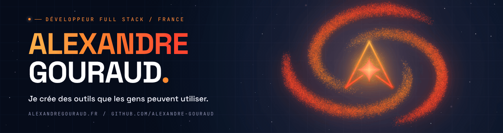
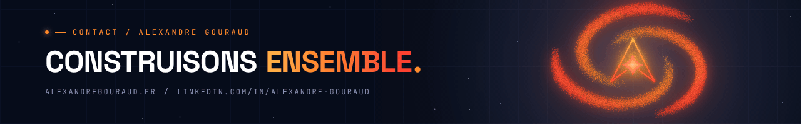

<!-- ═════════════════════════ HEADER — banner rotates hourly (banners.yml) ═════════════════════════ -->

<div align="center">
  
</div>

<div align="center">

<sub><a href="https://github.com/Alexandre-Gouraud">EN</a> · <b>FR</b></sub>

<picture><source media="(prefers-color-scheme: dark)" srcset="https://readme-typing-svg.demolab.com?font=JetBrains+Mono&weight=500&size=22&duration=3200&pause=900&color=FF8A1E&center=true&vCenter=true&width=680&height=50&lines=D%C3%A9veloppeur+Full+Stack+en+France;Next.js+%C2%B7+TypeScript+%C2%B7+Python+%C2%B7+Rust;Open+source+et+outils+self-hosted;Un+outil+utile+vaut+mieux+qu%27une+d%C3%A9mo+impressionnante." /><source media="(prefers-color-scheme: light)" srcset="https://readme-typing-svg.demolab.com?font=JetBrains+Mono&weight=500&size=22&duration=3200&pause=900&color=A45403&center=true&vCenter=true&width=680&height=50&lines=D%C3%A9veloppeur+Full+Stack+en+France;Next.js+%C2%B7+TypeScript+%C2%B7+Python+%C2%B7+Rust;Open+source+et+outils+self-hosted;Un+outil+utile+vaut+mieux+qu%27une+d%C3%A9mo+impressionnante." /></picture>

<p>
  <a href="https://alexandregouraud.fr/"></a>
  <a href="https://www.linkedin.com/in/alexandre-gouraud/"></a>
  <a href="mailto:contact@alexandregouraud.fr"></a>
</p>

<p>
  
  <a href="https://github.com/Alexandre-Gouraud?tab=followers"></a>
  <a href="https://github.com/Alexandre-Gouraud?tab=stars"></a>
</p>

</div>


<!-- ═════════════════════════ ABOUT ═════════════════════════ -->

<h2>✦&nbsp; À propos</h2>

Développeur full-stack basé en France. Je conçois des applications web de bout en bout — interface, API, déploiement. Ce qui me motive, c'est de transformer un besoin concret en quelque chose qui fonctionne vraiment, pas une démo qui rend bien en capture d'écran.

```yaml
nom:          Alexandre GOURAUD
rôle:         Développeur Full Stack
localisation: France
focus:        Next.js · TypeScript · Python · Rust
en_cours:     IA appliquée — pipelines RAG, LLM locaux, outils self-hosted
méthode:      [comprendre le besoin, prototyper, architecturer, livrer]
devise:       "Un outil utile vaut mieux qu'une démo impressionnante."
```

<!-- ═════════════════════════ AMBITIONS ═════════════════════════ -->

<h2>✦&nbsp; Ambitions</h2>

<table>
  <tr>
    <td width="33%" valign="top">
      <h4 align="center">I — Court terme</h4>
      <p align="center">Monter en puissance sur l'<b>IA appliquée</b> — RAG, LLM locaux, agents — et livrer des projets en production plutôt qu'au stade étudiant ou prototype.</p>
    </td>
    <td width="33%" valign="top">
      <h4 align="center">II — Moyen terme</h4>
      <p align="center">Maîtriser l'<b>architecture logicielle</b> et le DevOps de bout en bout : Docker, CI/CD, observabilité, systèmes performants en Rust.</p>
    </td>
    <td width="33%" valign="top">
      <h4 align="center">III — Long terme</h4>
      <p align="center">Construire des <b>produits open-source</b> utilisés au quotidien, et contribuer à un écosystème technique qui reste accessible.</p>
    </td>
  </tr>
</table>


<!-- ═════════════════════════ STACK ═════════════════════════ -->

<h2>✦&nbsp; Stack technique</h2>

<h3><code>01</code>&nbsp; Frontend</h3>

<p align="left">
  
</p>

<h3><code>02</code>&nbsp; Backend & Data</h3>

<p align="left">
  
</p>

<h3><code>03</code>&nbsp; Systèmes & DevOps</h3>

<p align="left">
  
</p>

<h3><code>04</code>&nbsp; Outils</h3>

<p align="left">
  
</p>

<h3><code>05</code>&nbsp; Design / UI</h3>

<p align="left">
  
  
</p>


<!-- ═════════════════════════ PROJECTS ═════════════════════════ -->

<h2>✦&nbsp; Projets</h2>

<table>
  <thead>
    <tr><th align="left">Projet</th><th align="left">Ce que c'est</th><th align="left">Stack</th></tr>
  </thead>
  <tbody>
    <tr>
      <td><code>01</code>&nbsp; <a href="https://github.com/Alexandre-Gouraud/Ollama_chat"><b>Ollama_chat</b></a></td>
      <td>Interface de chat pour exécuter des <b>LLM en local</b> via Ollama — conversations privées, aucune donnée ne sort de la machine.</td>
      <td> </td>
    </tr>
    <tr>
      <td><code>02</code>&nbsp; <a href="https://github.com/Alexandre-Gouraud/Filtro"><b>Filtro</b></a></td>
      <td><b>Application de traitement et de filtrage d'images</b> — application de filtres, prévisualisation et export.</td>
      <td> </td>
    </tr>
    <tr>
      <td><code>03</code>&nbsp; <a href="https://github.com/Alexandre-Gouraud/Rag_sanofi"><b>Rag_sanofi</b></a></td>
      <td><b>Pipeline RAG</b> (Retrieval-Augmented Generation) pour interroger une base documentaire métier en langage naturel.</td>
      <td>  </td>
    </tr>
    <tr>
      <td><code>04</code>&nbsp; <a href="https://github.com/Ky0sann/StreamApp_Swift"><b>StreamApp_Swift</b></a></td>
      <td><b>Application de streaming iOS native</b> développée en Swift — lecture de médias, navigation dans le catalogue, interface 100 % native.</td>
      <td> </td>
    </tr>
    <tr>
      <td><code>05</code>&nbsp; <a href="https://github.com/Alexandre-Gouraud/Projet-Blog-Pattes-Douces"><b>Projet-Blog-Pattes-Douces</b></a></td>
      <td><b>Plateforme de blog complète</b> autour des animaux — gestion de contenu, rendu côté serveur et interface responsive.</td>
      <td>  </td>
    </tr>
  </tbody>
</table>

<p align="left">
  <a href="https://github.com/Alexandre-Gouraud?tab=repositories"></a>
</p>


<!-- ═════════════════════════ STATS ═════════════════════════ -->

<h2>✦&nbsp; Statistiques GitHub</h2>

<div align="center">
  <picture><source media="(prefers-color-scheme: dark)" srcset="https://streak-stats.demolab.com?user=Alexandre-Gouraud&hide_border=true&border_radius=18&background=141D36&ring=FF8A1E&fire=FFD36B&currStreakNum=FFFFFF&sideNums=FFFFFF&currStreakLabel=FF8A1E&sideLabels=EEF1FB&dates=8B93B4&stroke=2B355C" /><source media="(prefers-color-scheme: light)" srcset="https://streak-stats.demolab.com?user=Alexandre-Gouraud&hide_border=true&border_radius=18&background=FBE9D6&ring=C5302E&fire=DD5800&currStreakNum=0C0E14&sideNums=0C0E14&currStreakLabel=C5302E&sideLabels=1B1E27&dates=5D6378&stroke=E8CDB0" /></picture>
</div>

<!--
<div align="center">
  <picture><source media="(prefers-color-scheme: dark)" srcset="https://github-readme-activity-graph.vercel.app/graph?username=Alexandre-Gouraud&bg_color=00000000&color=EEF1FB&line=FF8A1E&point=FFD36B&area=true&area_color=FF8A1E&hide_border=true" /><source media="(prefers-color-scheme: light)" srcset="https://github-readme-activity-graph.vercel.app/graph?username=Alexandre-Gouraud&bg_color=00000000&color=1B1E27&line=C5302E&point=DD5800&area=true&area_color=FF8A1E&hide_border=true" /></picture>
</div>
-->

<!-- ═════════════════════════ SNAKE (snake.yml) ═════════════════════════ -->

<div align="center">
  <br />
  <picture><source media="(prefers-color-scheme: dark)" srcset="https://raw.githubusercontent.com/Alexandre-Gouraud/Alexandre-Gouraud/output/github-snake-dark.svg" /><source media="(prefers-color-scheme: light)" srcset="https://raw.githubusercontent.com/Alexandre-Gouraud/Alexandre-Gouraud/output/github-snake.svg" /></picture>
</div>


<!-- ═════════════════════════ CONTACT ═════════════════════════ -->

<h2>✦&nbsp; Me contacter</h2>

Ouvert aux <b>opportunités</b>, aux <b>collaborations open-source</b> et aux discussions techniques. Le plus simple est le mail ou LinkedIn.

<p>
  <a href="mailto:contact@alexandregouraud.fr"></a>
  <a href="https://www.linkedin.com/in/alexandre-gouraud/"></a>
  <a href="https://alexandregouraud.fr/"></a>
</p>

<!-- ═════════════════════════ FOOTER ═════════════════════════ -->

<div align="center">
  <br />
  <sub><i>Merci d'être passé — n'hésite pas à parcourir les dépôts et à me faire signe.</i></sub>
  <br /><br />
  
</div>
