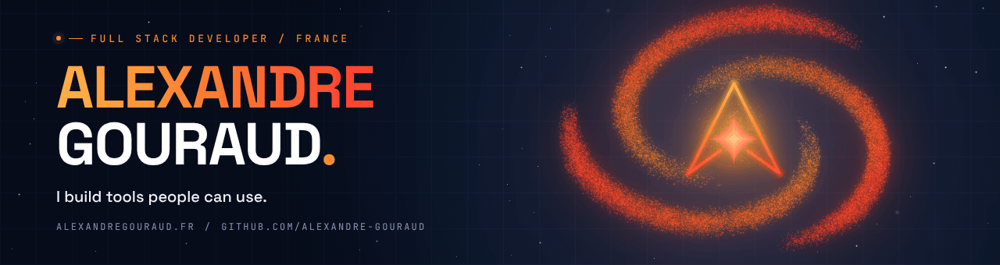
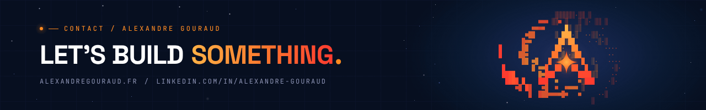

<!-- ═════════════════════════ HEADER — banner rotates hourly (banners.yml) ═════════════════════════ -->

<div align="center">
  
</div>

<div align="center">

<sub><b>EN</b> · <a href="https://github.com/Alexandre-Gouraud/Alexandre-Gouraud/blob/main/README.fr.md">FR</a></sub>

<picture><source media="(prefers-color-scheme: dark)" srcset="https://readme-typing-svg.demolab.com?font=JetBrains+Mono&weight=500&size=22&duration=3200&pause=900&color=FF8A1E&center=true&vCenter=true&width=680&height=50&lines=Full+Stack+Developer+based+in+France;Next.js+%C2%B7+TypeScript+%C2%B7+Python+%C2%B7+Rust;Open+source+and+self-hosted+tools;A+useful+tool+beats+an+impressive+demo." /><source media="(prefers-color-scheme: light)" srcset="https://readme-typing-svg.demolab.com?font=JetBrains+Mono&weight=500&size=22&duration=3200&pause=900&color=A45403&center=true&vCenter=true&width=680&height=50&lines=Full+Stack+Developer+based+in+France;Next.js+%C2%B7+TypeScript+%C2%B7+Python+%C2%B7+Rust;Open+source+and+self-hosted+tools;A+useful+tool+beats+an+impressive+demo." /></picture>

<p>
  <a href="https://alexandregouraud.fr/"></a>
  <a href="https://www.linkedin.com/in/alexandre-gouraud/"></a>
  <a href="mailto:contact@alexandregouraud.fr"></a>
</p>

<p>
  
  <a href="https://github.com/Alexandre-Gouraud?tab=followers"></a>
  <a href="https://github.com/Alexandre-Gouraud?tab=stars"></a>
</p>

</div>


<!-- ═════════════════════════ ABOUT ═════════════════════════ -->

<h2>✦&nbsp; About</h2>

Full-stack developer based in France. I build web applications end to end — interface, API, deployment. What drives me is turning a concrete need into something that actually works, not a demo that only looks good in a screenshot.

```yaml
name:      Alexandre GOURAUD
role:      Full Stack Developer
location:  France
focus:     Next.js · TypeScript · Python · Rust
building:  applied AI — RAG pipelines, local LLMs, self-hosted tools
method:    [understand the need, prototype, architect properly, ship]
motto:     "A useful tool beats an impressive demo."
```

<!-- ═════════════════════════ AMBITIONS ═════════════════════════ -->

<h2>✦&nbsp; Ambitions</h2>

<table>
  <tr>
    <td width="33%" valign="top">
      <h4 align="center">I — Short term</h4>
      <p align="center">Go deeper into <b>applied AI</b> — RAG, local LLMs, agents — and ship projects to production instead of leaving them at student or prototype stage.</p>
    </td>
    <td width="33%" valign="top">
      <h4 align="center">II — Mid term</h4>
      <p align="center">Master <b>software architecture</b> and end-to-end DevOps: Docker, CI/CD, observability, and performance-critical systems in Rust.</p>
    </td>
    <td width="33%" valign="top">
      <h4 align="center">III — Long term</h4>
      <p align="center">Build <b>open-source products</b> people use daily, and contribute to a technical ecosystem that stays accessible to everyone.</p>
    </td>
  </tr>
</table>


<!-- ═════════════════════════ STACK ═════════════════════════ -->

<h2>✦&nbsp; Tech Stack</h2>

<h3><code>01</code>&nbsp; Frontend</h3>

<p align="left">
  
</p>

<h3><code>02</code>&nbsp; Backend & Data</h3>

<p align="left">
  
</p>

<h3><code>03</code>&nbsp; Systems & DevOps</h3>

<p align="left">
  
</p>

<h3><code>04</code>&nbsp; Tools</h3>

<p align="left">
  
</p>

<h3><code>05</code>&nbsp; Design / UI</h3>

<p align="left">
  
  
</p>


<!-- ═════════════════════════ PROJECTS ═════════════════════════ -->

<h2>✦&nbsp; Projects</h2>

<table>
  <thead>
    <tr><th align="left">Project</th><th align="left">What it is</th><th align="left">Stack</th></tr>
  </thead>
  <tbody>
    <tr>
      <td><code>01</code>&nbsp; <a href="https://github.com/Alexandre-Gouraud/Ollama_chat"><b>Ollama_chat</b></a></td>
      <td>Chat interface for running <b>LLMs locally</b> through Ollama — private conversations, nothing ever leaves the machine.</td>
      <td> </td>
    </tr>
    <tr>
      <td><code>02</code>&nbsp; <a href="https://github.com/Alexandre-Gouraud/Filtro"><b>Filtro</b></a></td>
      <td><b>Image processing and filtering app</b> — apply filters, preview the result, export the output.</td>
      <td> </td>
    </tr>
    <tr>
      <td><code>03</code>&nbsp; <a href="https://github.com/Alexandre-Gouraud/Rag_sanofi"><b>Rag_sanofi</b></a></td>
      <td><b>RAG pipeline</b> (Retrieval-Augmented Generation) to query a business document base in natural language.</td>
      <td>  </td>
    </tr>
    <tr>
      <td><code>04</code>&nbsp; <a href="https://github.com/Ky0sann/StreamApp_Swift"><b>StreamApp_Swift</b></a></td>
      <td><b>Native iOS streaming app</b> built in Swift — media playback, catalog browsing and a fully native interface.</td>
      <td> </td>
    </tr>
    <tr>
      <td><code>05</code>&nbsp; <a href="https://github.com/Alexandre-Gouraud/Projet-Blog-Pattes-Douces"><b>Projet-Blog-Pattes-Douces</b></a></td>
      <td><b>Full blog platform</b> about animals — content management, server-side rendering and a responsive interface.</td>
      <td>  </td>
    </tr>
  </tbody>
</table>

<p align="left">
  <a href="https://github.com/Alexandre-Gouraud?tab=repositories"></a>
</p>


<!-- ═════════════════════════ STATS ═════════════════════════ -->

<h2>✦&nbsp; GitHub stats</h2>

<div align="center">
  <picture><source media="(prefers-color-scheme: dark)" srcset="https://streak-stats.demolab.com?user=Alexandre-Gouraud&hide_border=true&border_radius=18&background=141D36&ring=FF8A1E&fire=FFD36B&currStreakNum=FFFFFF&sideNums=FFFFFF&currStreakLabel=FF8A1E&sideLabels=EEF1FB&dates=8B93B4&stroke=2B355C" /><source media="(prefers-color-scheme: light)" srcset="https://streak-stats.demolab.com?user=Alexandre-Gouraud&hide_border=true&border_radius=18&background=FBE9D6&ring=C5302E&fire=DD5800&currStreakNum=0C0E14&sideNums=0C0E14&currStreakLabel=C5302E&sideLabels=1B1E27&dates=5D6378&stroke=E8CDB0" /></picture>
</div>

<!--
<div align="center">
  <picture><source media="(prefers-color-scheme: dark)" srcset="https://github-readme-activity-graph.vercel.app/graph?username=Alexandre-Gouraud&bg_color=00000000&color=EEF1FB&line=FF8A1E&point=FFD36B&area=true&area_color=FF8A1E&hide_border=true" /><source media="(prefers-color-scheme: light)" srcset="https://github-readme-activity-graph.vercel.app/graph?username=Alexandre-Gouraud&bg_color=00000000&color=1B1E27&line=C5302E&point=DD5800&area=true&area_color=FF8A1E&hide_border=true" /></picture>
</div>
-->

<!-- ═════════════════════════ SNAKE (snake.yml) ═════════════════════════ -->

<div align="center">
  <br />
  <picture><source media="(prefers-color-scheme: dark)" srcset="https://raw.githubusercontent.com/Alexandre-Gouraud/Alexandre-Gouraud/output/github-snake-dark.svg" /><source media="(prefers-color-scheme: light)" srcset="https://raw.githubusercontent.com/Alexandre-Gouraud/Alexandre-Gouraud/output/github-snake.svg" /></picture>
</div>


<!-- ═════════════════════════ CONTACT ═════════════════════════ -->

<h2>✦&nbsp; Get in touch</h2>

Open to <b>opportunities</b>, <b>open-source collaborations</b> and technical conversations. Email or LinkedIn is the fastest way to reach me.

<p>
  <a href="mailto:contact@alexandregouraud.fr"></a>
  <a href="https://www.linkedin.com/in/alexandre-gouraud/"></a>
  <a href="https://alexandregouraud.fr/"></a>
</p>

<!-- ═════════════════════════ FOOTER ═════════════════════════ -->

<div align="center">
  <br />
  <sub><i>Thanks for stopping by — feel free to dig through the repos and say hello.</i></sub>
  <br /><br />
  
</div>
